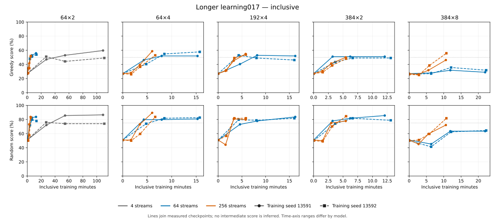

# Longer size and batching comparison: evidence for MTG-122

The frozen rule selects **64×2, 256 streams**. Recommendation evidence concerns its full 524,288-transition recipe (32 iterations), even though sustained qualification first appeared at 524,288 transitions. The exact resolved recipe is [retained here](recipes/small-s256.json).

This package contains the completed 22-fit comparison, both training seeds,
four exact raw checkpoints and all 18,304 replay-verified evaluation games.
The final interpretation and actual figures still require operator review.

## Measured endpoint

| Model | Streams | Seed | Greedy | Random | Greedy gain (pp) | Inclusive fit min | Active min | Adam steps | Selected exposures | Empty groups skipped | Peak CUDA GiB |
|---|---:|---:|---:|---:|---:|---:|---:|---:|---:|---:|---:|
| 64×2 | 4 | 13591 | 59.62% | 86.54% | +32.69 | 109.041 | 106.943 | 91,702 | 128,591 | 39,370 | 0.098 |
| 64×2 | 4 | 13592 | 49.04% | 74.04% | +22.12 | 110.843 | 108.711 | 88,643 | 122,613 | 42,429 | 0.098 |
| 64×2 | 64 | 13591 | 55.77% | 83.65% | +28.85 | 12.647 | 12.505 | 8,192 | 131,072 | 0 | 0.397 |
| 64×2 | 64 | 13592 | 53.85% | 77.88% | +26.92 | 13.311 | 13.221 | 8,192 | 131,072 | 0 | 0.410 |
| 64×2 | 256 | 13591 | 50.96% | 83.65% | +24.04 | 4.811 | 4.776 | 2,048 | 131,072 | 0 | 1.303 |
| 64×2 | 256 | 13592 | 51.92% | 82.69% | +25.00 | 5.220 | 5.183 | 2,048 | 131,072 | 0 | 1.374 |
| 64×4 | 64 | 13591 | 51.92% | 80.77% | +25.00 | 15.292 | 15.192 | 8,192 | 131,072 | 0 | 0.541 |
| 64×4 | 64 | 13592 | 57.69% | 82.69% | +30.77 | 15.747 | 15.647 | 8,192 | 131,072 | 0 | 0.588 |
| 64×4 | 256 | 13591 | 58.65% | 89.42% | +31.73 | 6.024 | 5.988 | 2,048 | 131,072 | 0 | 1.961 |
| 64×4 | 256 | 13592 | 52.88% | 83.65% | +25.96 | 6.644 | 6.603 | 2,048 | 131,072 | 0 | 2.155 |
| 192×4 | 64 | 13591 | 51.92% | 83.65% | +25.00 | 16.237 | 16.123 | 8,192 | 131,072 | 0 | 0.912 |
| 192×4 | 64 | 13592 | 46.15% | 81.73% | +19.23 | 16.053 | 15.942 | 8,192 | 130,474 | 0 | 1.341 |
| 192×4 | 256 | 13591 | 54.81% | 79.81% | +27.88 | 5.784 | 5.743 | 2,048 | 131,072 | 0 | 3.237 |
| 192×4 | 256 | 13592 | 53.85% | 81.73% | +26.92 | 5.831 | 5.788 | 2,048 | 130,358 | 0 | 4.762 |
| 384×2 | 64 | 13591 | 50.96% | 85.58% | +24.04 | 12.085 | 11.978 | 8,192 | 130,953 | 0 | 1.400 |
| 384×2 | 64 | 13592 | 49.04% | 78.85% | +22.12 | 13.105 | 12.991 | 8,192 | 131,072 | 0 | 1.751 |
| 384×2 | 256 | 13591 | 50.00% | 77.88% | +23.08 | 5.457 | 5.405 | 2,048 | 130,583 | 0 | 4.773 |
| 384×2 | 256 | 13592 | 48.08% | 84.62% | +21.15 | 5.515 | 5.460 | 2,048 | 131,072 | 0 | 5.833 |
| 384×8 | 64 | 13591 | 28.85% | 63.46% | +1.92 | 21.969 | 21.783 | 8,115 | 58,467 | 77 | 3.594 |
| 384×8 | 64 | 13592 | 31.73% | 64.42% | +5.77 | 22.265 | 22.094 | 8,099 | 56,973 | 93 | 2.304 |
| 384×8 | 256 | 13591 | 46.15% | 72.12% | +19.23 | 10.607 | 10.515 | 2,048 | 122,428 | 0 | 13.402 |
| 384×8 | 256 | 13592 | 55.77% | 81.73% | +29.81 | 10.767 | 10.668 | 2,048 | 128,497 | 0 | 7.875 |

Scores use 104 games per anchor/checkpoint: 13 paired deal blocks with eight
seat/deck/mirror legs. Wins count as 1, draws as 0.5, losses as 0. Each seed stays
separate. [All checkpoint scores and initialization-relative intervals](checkpoint-scores.md),
[all four deck-role cells](deck-role-scores.csv), and [complete paired comparisons](analysis.json)
remain available. Deck-role results accompany the aggregate scores.

## Frozen competence rule

| Recipe | Sustained qualification | First qualifying transitions | Worst seed minutes to qualification | Parameters |
|---|---|---:|---:|---:|
| large-s256 | Did not pass | — | — | 16,816,514 |
| large-s64 | Did not pass | — | — | 16,816,514 |
| large-shallow-s256 | Did not pass | — | — | 6,169,730 |
| large-shallow-s64 | Did not pass | — | — | 6,169,730 |
| middle-s256 | Passed | 524,288 | 5.830 | 2,463,170 |
| middle-s64 | Did not pass | — | — | 2,463,170 |
| small-deep-s256 | Passed | 524,288 | 6.642 | 288,578 |
| small-deep-s64 | Passed | 262,144 | 8.513 | 288,578 |
| small-s256 | Passed | 524,288 | 5.218 | 188,610 |
| small-s4 | Did not pass | — | — | 188,610 |
| small-s64 | Passed | 262,144 | 6.883 | 188,610 |

Qualification requires both seeds at ≥50% against greedy, ≥75% against random,
and ≥20 percentage points greedy improvement from their own initialization,
at the selected checkpoint and all later retained points. Choose the smallest
worst-seed time; within 10%, prefer fewer parameters, then lower CUDA memory.
This is an operational rule, not a population significance test or skill ceiling.
An early threshold crossing does not authorize shortening the tested schedule.

## Recipe clocks and transfer

Source: `3c3681d2b26a7fc8167928fa63fe24a6cd3d058a`. All fits use corrected w6, cross-balanced current-self,
64 transitions/stream, Ataraxos MOVE/Adam, FP32 with TF32 off, one CPU producer/thread,
and RTX 5090. [Complete recipes](recipes/index.json) preserve all learner parameters.

For K iterations and R=2048 reference iterations, r(i)=1+(i-1)*(R-1)/(K-1); four streams use r(i)=i. LR=clamp(0.5/r(i)^1.1,5e-6,1e-4); tau=0.05/r(i)^0.3.

The full horizon is 524,288 transitions. Four/64/256 streams use 2,048/128/32
iterations respectively, with raw checkpoints at 0/131,072/262,144/524,288 transitions.
The learning rate remains 1e-4 over this tested horizon. EMA stays 0.999 per iteration.
Batching changes optimizer grouping, update opportunities, filtering and staleness;
these results compare whole recipes and do not isolate a single cause.

MTG-122's current saved direction selects 64-stream GPU training, Mini evaluation,
all 36,000 assessment games and its own shared research catalog. A 256-stream result
would be an alternative to that selected stream count, not an automatic amendment.
Keep common learnable tensor shapes across its pools, exact native-content admission,
fresh initializations and its fixed controls. This grid's product checkpoint identities
and transport-ID buffers are not interchangeable with the research catalog.
Recalibrate all three pools with its final source and diagnostics setting: these
measurements retain inline diagnostics and do not quote the split pipeline's cost.
This package changes no execution authorization or existing cohort.

## Time and cost

| Training seed | Worker start to first cell, min | Sum inclusive fit min | Request-to-deletion hours | Quoted hourly rate | Conservative occupied-cost floor |
|---|---:|---:|---:|---:|---:|
| 13591 | 7.51 | 219.96 | 4.019 | $1.19 | $4.782 |
| 13592 | 7.34 | 225.30 | 4.051 | $1.19 | $4.821 |

The study's conservative settled charge is $10.
Campaign accounting is $33.5 settled,
$0 in open reservations and $5
ancillary reserve within the authorized $50.
SDK charges and quote-based occupied-time floors are not final provider invoices.
The independent MTG-121 startup budget remains separate.

Inclusive checkpoint clocks stop at the retained stage coordinate; inclusive fit
clocks also include final run bookkeeping. Active time is collection plus learning.
Worker phase intervals include dispatch/export/check overhead. Shared startup and
retention are not assigned to individual recipes. The local CPU evaluation used
7.585 hours of coordinator wall time
and no rented GPU. [Resource records](resources.json) preserve the separate counters.

## Limits and provenance

Two training seeds give a limited view of training variability. The paired-deal
bootstrap intervals condition on each seed; they neither estimate population
training variance nor correct the many grid comparisons. Scores at intermediate
wall times were not measured. Different earlier normalized schedules mean the
131,072 point here is not another replicate of the short screen.

The two-rental account rule was exceeded at admission when another task's pod
appeared while local jobs were queued. The controller omitted queued reservations
from its count, and the two admitted rentals made three account pods. Existing
trajectories were preserved and further admissions held. No scientific recipe,
source, checkpoint, endpoint or budget was extended. Earlier CUDA initialization
failures and the historical finite-weight anomaly remain unresolved; this cohort's
health checks do not establish their causes.

All facts derive from the [frozen protocol](protocol.md), [allocation](allocation.json),
[audited analysis](analysis.json) and [resources](resources.json). The manifest binds
this rendered package. The [analysis source archive](analysis-source/README.md)
retains the exact programs and documents the additional runtime/data prerequisites.
The [training verification](training-verification.json) retains raw-checkpoint,
recipe, numerical-audit and per-phase timing evidence. [Evaluation verification](evaluation-verification.json),
[runtime identity](evaluation-runtime.json) and [rental settlement](rental-settlement.json)
remain separate receipts, rather than being inferred from the score table.
The [guardian payload check](guardian-verification.json) binds both provider
allocations to the inspected independent in-pod deadline program; it is not
proof of a live guardian process or final provider deletion.
The [prospective concurrency amendment](concurrency-amendment.md) records the
operator's correction of an unsupported account-wide rental limit so the separately
budgeted startup test could run alongside this study. Frozen scientific inputs and
analysis were unchanged; earlier admission deviations remain part of the record.
MTG-151's approximately 20k-update follow-up remains paused;
it neither extends this cohort nor supplies evidence of a higher skill ceiling.
