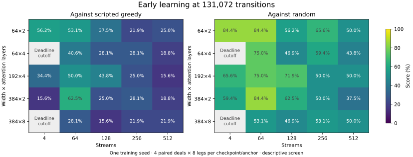

# Early learning across model size and batching

Updated 2026-10-18 UTC under [frozen protocol 013](protocols/grid-early-learning-013.md).
The grid now contains **23 verified complete cells out of 25**. The remaining two
four-stream runs reached their learner deadlines and remain separate partial results.

The small 64×2 model scored 53.1% against scripted greedy and
84.4% against random at 64 streams, compared with
56.2% and 84.4% at four streams. Its observed
training duration fell from 1778.0 to
296.9 seconds. At 256 streams it took
83.8 seconds but scored
21.9% and 65.6%. This is an early
speed/learning tradeoff; it does not establish equivalent playing strength.

The added 64×4 model scored 40.6% against greedy at 64 streams
and 28.1% at 256. The added 384×2 model scored
62.5% and 28.1% respectively; at 64
streams it also scored 84.4% against random.
These are short-horizon observations, not evidence of an architecture's skill ceiling.

## Observed cells

Every complete cell uses training seed 13571 and exactly 131,072 transitions.
Each endpoint and its own initialization were evaluated against both anchors on
four paired deals and eight seat/deck/mirror legs: 32 games per checkpoint/anchor.
Scores count a win as 1, a draw as 0.5 and a loss as 0. Initialization scored
15.625% against greedy and 46.875% against random for every observed cell.
Parentheses show improvement in percentage points from that initialization.

| Width × layers | Streams | Training seconds | Greedy score (change) | Random score (change) |
|---|---:|---:|---:|---:|
| 64×2 | 4 | 1778.0 | 56.2% (+40.6) | 84.4% (+37.5) |
| 64×2 | 64 | 296.9 | 53.1% (+37.5) | 84.4% (+37.5) |
| 64×2 | 128 | 129.2 | 37.5% (+21.9) | 56.2% (+9.4) |
| 64×2 | 256 | 83.8 | 21.9% (+6.2) | 65.6% (+18.8) |
| 64×2 | 512 | 61.9 | 25.0% (+9.4) | 50.0% (+3.1) |
| 64×4 | 4 | 1800.1 | Cut off at 112,384 transitions | — |
| 64×4 | 64 | 278.8 | 40.6% (+25.0) | 75.0% (+28.1) |
| 64×4 | 128 | 168.2 | 28.1% (+12.5) | 46.9% (+0.0) |
| 64×4 | 256 | 111.8 | 28.1% (+12.5) | 59.4% (+12.5) |
| 64×4 | 512 | 66.0 | 18.8% (+3.1) | 43.8% (-3.1) |
| 192×4 | 4 | 1756.4 | 34.4% (+18.8) | 65.6% (+18.8) |
| 192×4 | 64 | 220.5 | 50.0% (+34.4) | 75.0% (+28.1) |
| 192×4 | 128 | 171.3 | 43.8% (+28.1) | 71.9% (+25.0) |
| 192×4 | 256 | 112.3 | 25.0% (+9.4) | 50.0% (+3.1) |
| 192×4 | 512 | 80.6 | 15.6% (+0.0) | 50.0% (+3.1) |
| 384×2 | 4 | 1392.7 | 15.6% (+0.0) | 59.4% (+12.5) |
| 384×2 | 64 | 197.8 | 62.5% (+46.9) | 84.4% (+37.5) |
| 384×2 | 128 | 120.7 | 25.0% (+9.4) | 62.5% (+15.6) |
| 384×2 | 256 | 101.4 | 28.1% (+12.5) | 50.0% (+3.1) |
| 384×2 | 512 | 72.2 | 18.8% (+3.1) | 37.5% (-9.4) |
| 384×8 | 4 | 1800.1 | Cut off at 97,024 transitions | — |
| 384×8 | 64 | 391.4 | 28.1% (+12.5) | 53.1% (+6.2) |
| 384×8 | 128 | 365.6 | 15.6% (+0.0) | 46.9% (+0.0) |
| 384×8 | 256 | 166.3 | 21.9% (+6.2) | 53.1% (+6.2) |
| 384×8 | 512 | 140.6 | 21.9% (+6.2) | 50.0% (+3.1) |

The 64×4 four-stream run stopped at 112,384 transitions; the 384×8 four-stream
run stopped at 97,024. Neither was evaluated as a shorter substitute for the
declared endpoint. Pre-training infrastructure failures remain separate from
model outcomes, and their costs remain in the ledger.

## What this supports

Transitions per second alone cannot select the training recipe. With 64
transitions per stream, 4/64/128/256/512 streams produce 512/32/16/8/4 iterations
at this experience budget. The reduction in update opportunities follows directly
from the implementation. The retained measurements quantify actual Adam steps,
filtered exposure and learning outcomes; they do not identify which coupled
mechanism causes the score differences. The current implementation also changes
sample grouping, policy staleness and EMA updates per transition.

Update count alone does not explain the results. The 384×2 four-stream run made
9,602 Adam steps and skipped 23,166 empty filtered timestep groups, yet its greedy
score stayed at initialization. At 64 streams it made 2,048 Adam steps, skipped
none and scored 62.5%. These observations keep filtering and sample grouping
relevant alongside update frequency; this screen does not isolate their effects.

The longer [protocol 017 comparison](protocols/longer-learning-017.md) preserves
all five architectures at both 64 and 256 streams, plus the small four-stream
reference. Two fresh training seeds each receive 524,288 transitions, with raw
checkpoints at 0, 131,072, 262,144 and 524,288. The allocation and selection rule
were frozen before these added-cell scores were analyzed. It tests whether the
early tradeoff persists over four times as much experience and independent training
seeds; it still does not establish an ultimate skill ceiling.

The longer study's admission deviated from its account-wide two-rental rule.
Another task's pod appeared while our jobs were queued, and the launcher omitted
queued local jobs from its provider-visible capacity count. Our two rentals then
made three account pods. The running trajectories were preserved and further
admissions held. This is a recorded operational deviation; the scientific recipe,
seeds, source, checkpoints and reserved $17.50 allocation were unchanged.

## Limits and evidence

Four deal blocks are correlated repeated measures, not 32 independent samples.
One training seed gives no estimate of training-seed variability. The
[expanded summary](data/grid-early-learning-013-expanded-summary.json) preserves
every paired deal-block score and descriptive exact 4^4 block-bootstrap interval,
as well as both cohorts' original verification receipts. These intervals do not
correct for the grid comparisons or establish noninferiority. Different hosts
limit direct throughput comparisons across models. The added architectures share
one rental per architecture across stream counts; original cells generally used
different rentals. This screen does not resolve historical CUDA/NVML failures or
the finite-weight anomaly.

Across both cohorts, all 46 commands, 92 checkpoint/opponent panels and 2,944
games completed. All 1,715 manifest entries
verify by bytes and SHA256. Exact checkpoint coordinates, source/runtime identities,
frozen protocol, seat/deck/registration bindings, full trace hashes and replay
receipts pass. Recomputed ordinary monitor summaries reproduce the stored scores.
Evaluation used the validated local CPU route 012, with no GPU rental. The older
Linux GPU calibration scores are not mixed into this screen.

The unchanged [original 12-cell summary](data/grid-early-learning-013-summary.json)
preserves the first cohort. Raw evidence remains under
`.runs/grid-007/early-learning-013/` and `early-learning-013-added/`; their analysis
directories retain full verification receipts. The raw manifest SHA256 values are
`f3425a5ce00053a357370aeda8e49ee95852d48c89aa2f7f79bf4fd7a1999973` and
`80d58d81a67bc65d05b4749456003a55cac7e2594e7ac0eb42b062a54a963736`. The shared protocol SHA256 is
`93001968b52f1624bb7128ab41bab80d15516689af6ae90d08aa462cfda3c08d`. Training source is `f057cfebb3e9be07addfff9ae7e04c0106b85ef3`
for the original models and `9a1faddb96ba518d9b6e63eed545f157d9771c6c` for the added
architectures. Their manabot/managym source and dependency locks are identical;
runner changes expose the added capacities. New numerical audits are coarse
retained-state checks, not a guarantee that every individual update was correct.
