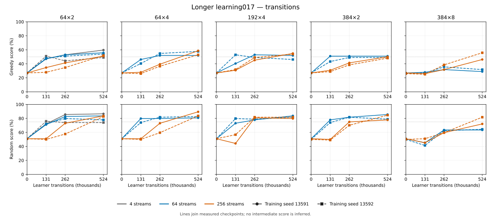
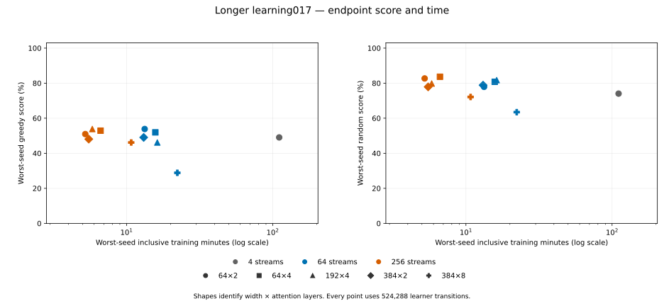

# Longer learning across model size and batching

Completed 2026-10-19 under [frozen protocol 017](protocols/longer-learning-017.md).
This extends the [short early-learning screen](grid-early-learning-013.md) to
524,288 learner transitions per fit, using two training seeds.

The comparison has 22 fits on RTX 5090 rentals. Each fit was evaluated at four
raw checkpoints in 18,304 replay-verified games on a local CPU host. The rendered
[evidence package](data/longer-learning-017/evidence.md) has the complete tables,
paired-deal intervals, deck-role results and receipts. Its
[manifest](data/longer-learning-017/manifest.json) binds all 53 files.

## Result

**Batching buys a large, reliable speedup, and the smallest model learns as
well as the larger ones at this horizon.**

- At equal experience (524,288 transitions), 64×2 training took 109–111
  minutes at 4 streams, 12.6–13.3 at 64, and 4.8–5.2 at 256. Every model except
  384×8 trained in 12.1–16.2 minutes at 64 streams and 4.8–6.6 minutes at 256.
- Under the frozen competence rule, the fastest recipe was **64×2 at 256 streams**:
  [small-s256](data/longer-learning-017/recipes/small-s256.json), with a
  worst-seed time to qualification of 5.2 minutes. At 64 streams,
  [small-s64](data/longer-learning-017/recipes/small-s64.json) qualified first,
  at 6.9 minutes. 64×4 followed at 8.5 minutes.
- Excluding 384×8 at 64 streams, endpoints fell between 46% and 60% against
  scripted greedy and between 74% and 89% against random. Each endpoint uses 104
  games per anchor, and there are two training seeds. That is not enough to rank
  the models, and the larger models showed no advantage.

## Batching changes the learning curve

At 64 streams, scores rise by 131k–262k transitions and then flatten. At 256
streams, they improve more slowly per transition and are still rising at 524k.
Because training is 2.2–2.8× faster at 256 streams, the 256-stream
fits reach the same endpoint in about 40% of the wall time. The short screen's
weak 256-stream result reflected its short horizon rather than a ceiling.

These are whole-recipe comparisons. At fixed experience, more streams means
fewer Adam steps: 8,192 at 64 streams versus 2,048 at 256. It also changes
selection filtering and policy staleness. This study does not separate those
causes.

## 384×8 at 64 streams is unexplained

The deepest model at 64 streams used about 57k of its 131k planned selected
exposures. It skipped 77–93 empty groups and reached only 29–32% against
greedy. The same model at 256 streams used 122k–128k exposures and reached
46–56%. The cause is not established, so treat the result as unexplained rather
than as evidence that deep models fail.

## Competence rule

A recipe qualifies at a checkpoint when both seeds meet three conditions at that
checkpoint and every later one:

- at least 50% against greedy;
- at least 75% against random;
- at least 20 points of greedy improvement over their own initialization.

The rule chooses the smallest worst-seed time to qualification. Among recipes
within 10% of that time, it prefers fewer parameters, then lower CUDA memory.

This is an operational rule, not a significance test or an estimate of skill
ceiling. The paired-deal bootstrap intervals are conditional on each training
seed. They do not estimate training variance or correct for multiple comparisons.

## Costs and provenance

- Training source is `3c3681d2b26a7fc8167928fa63fe24a6cd3d058a`.
- Settled GPU charge was $10, within the campaign's $50 authorization.
- CPU evaluation took 7.6 coordinator hours on a local host.
- Raw checkpoints and per-panel evaluation evidence remain under
  `.runs/grid-007/learning-017/` and `.runs/grid-007/learning-017-mini-final-20261019/`.
- At admission, a third account pod briefly existed alongside the two rentals.
  The [concurrency amendment](data/longer-learning-017/concurrency-amendment.md)
  records this deviation; frozen inputs and analysis were not changed.

Evaluation cost scales strongly with model size. At 64 streams, a 416-game
command took about 21 minutes for 64×2 and 55–67 minutes for 384×2. This favors
the small model for evaluation-heavy work.
